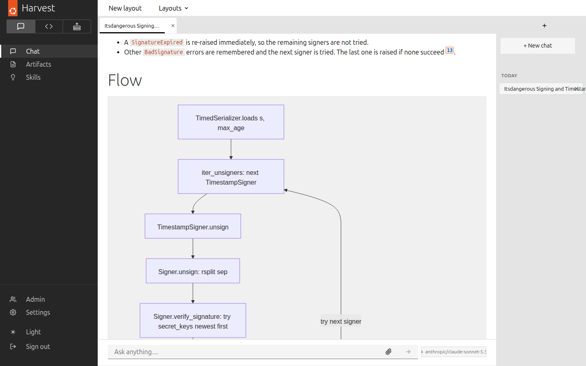

# What Harvest is

Harvest is a self-hosted assistant for software teams. It reads your repositories once, keeps a structured model of the code, and lets an AI agent use that model to answer questions, write code and plan deployments.

It has three modes, each a different job:

| Mode | Job | Output |
|---|---|---|
| **Chat** | understand code | answers with citations, diagrams, artifacts |
| **Code** | change code | commits on a branch, live previews, change requests |
| **Deploy** | run code | design documents, deployment artifacts, runs on your machines |

## Why self-hosted

Code, credentials and conversations stay on your infrastructure. Harvest talks to the model providers you choose, with your keys or your users' keys, and to git hosts with your users' own credentials. Coding containers and machine agents run on servers you control.

## Why a code graph

Language models answer badly about code they cannot see and run out of context on code they see all at once. Harvest parses every version of every repository into symbols, calls, imports and inheritance, and gives the agent tools to search and walk that graph. The agent reads only what a question needs, and every claim can cite the lines it came from. See [How Harvest understands code](code-understanding.md).

## Who it is for

- Developers learning an unfamiliar codebase, or comparing versions of one.
- Teams that want an agent to build and test changes in isolation, then review them like any other contribution.
- Operators who turn requirements into infrastructure and want the steps written, reviewed and run in one place.
