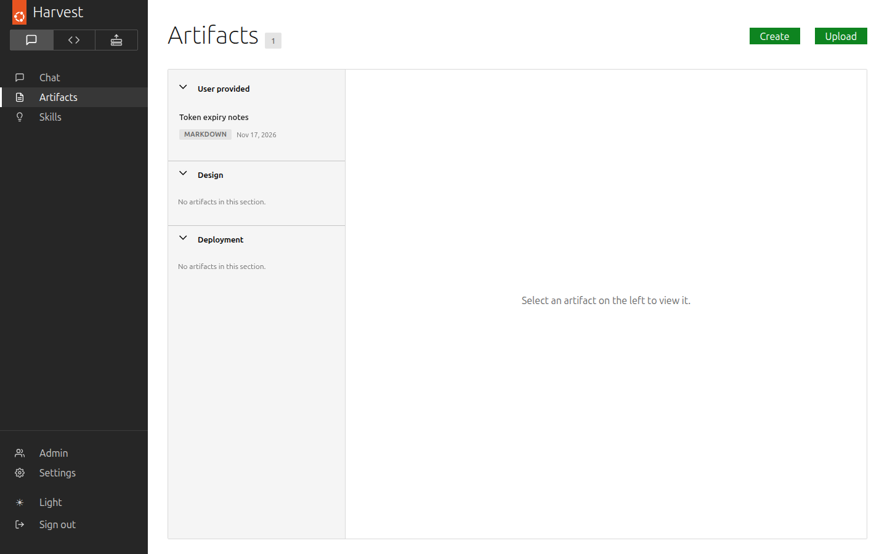

# Keep answers as artifacts

**Goal:** turn an answer into a document you can edit, share or run.

Artifacts live in two places:

- **Chat → Artifacts**: your personal artifacts.
- **Deploy → Artifacts**: a project's artifacts, shared with its members. Designs and deployment artifacts are kept here.

Create one by asking in chat (*"Save this as an artifact called Token expiry notes"*), or select **Create artifact** on the Artifacts page.

| Type | Use |
|---|---|
| Markdown | notes, requirements, runbooks |
| PDF (markdown source) | documents to hand out; downloaded as PDF |
| Terraform / Terragrunt (JSON bundle) | infrastructure, run on an agent |
| Bash script | scripts, run on an agent |

Open an artifact to edit it or download it. In a project, Terraform and Bash artifacts can be run with **Run on agent** (plan, apply or destroy for Terraform).

