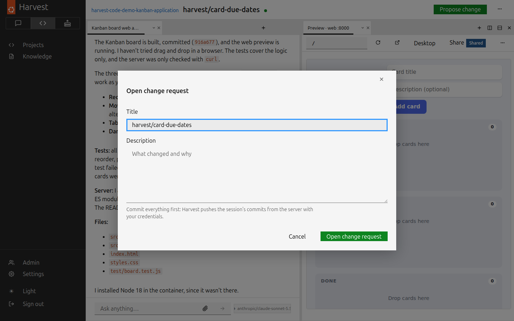

# Open and update a change request

**Goal:** turn a session's branch into a pull request, merge request or review.

1. Make sure the work is committed (ask the agent to commit if needed) and that you have a [platform account](connect-git-platforms.md) for the repository's host.
2. Select **Propose change** in the session header.
3. Enter a **Title** and **Description** (*What changed and why*), and select **Open change request**.

Harvest pushes the branch from the server with your credentials and opens a pull request (GitHub, Gitea), a merge request (GitLab), a Gerrit change (pushed to `refs/for/<base>` with a topic) or a merge proposal (Launchpad). A chip in the header links to it and shows its state.

The agent can also propose the change itself with its `propose_change` tool when you ask it to.

**Update it:** after new commits, select **Push to change request** (or **Push commits**).

When the change request is merged, the session ends automatically. Platform details: [Change request platforms](../reference/change-request-platforms.md).
