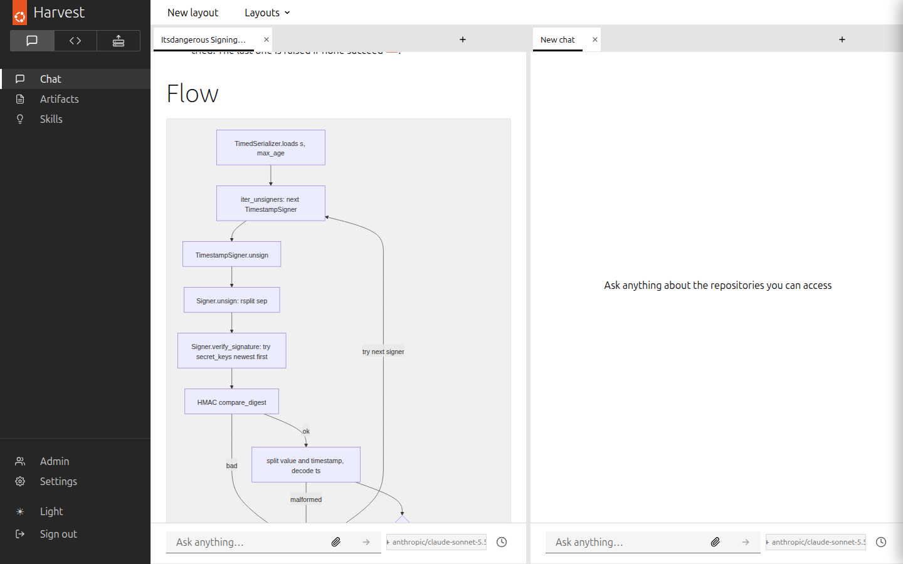

# Use tabs, split panes and saved layouts

**Goal:** keep several conversations on screen.

| To | Do |
|---|---|
| Open a tab | **+** in the pane's tab bar, or `Ctrl+Alt+T` |
| Split to the right | split button, or `Ctrl+Alt+\` |
| Split below | split-below button, or `Ctrl+Alt+-` |
| Close a tab | **×** on the tab, or `Ctrl+Alt+W` |
| Move a tab | drag it to another pane's tab bar, or to a pane edge to split there |
| Resize panes | drag the gutter between them |

Shortcuts act on the pane you last clicked. Split and close buttons appear when you point at or focus a pane.

**Save a layout:** open **Layouts**, type a name and select **Save**. Pick it from the same menu later. **New layout** starts from one empty tab and offers to save the current one first.

Your current layout is saved automatically, separately for personal chat and for each Deploy project.
