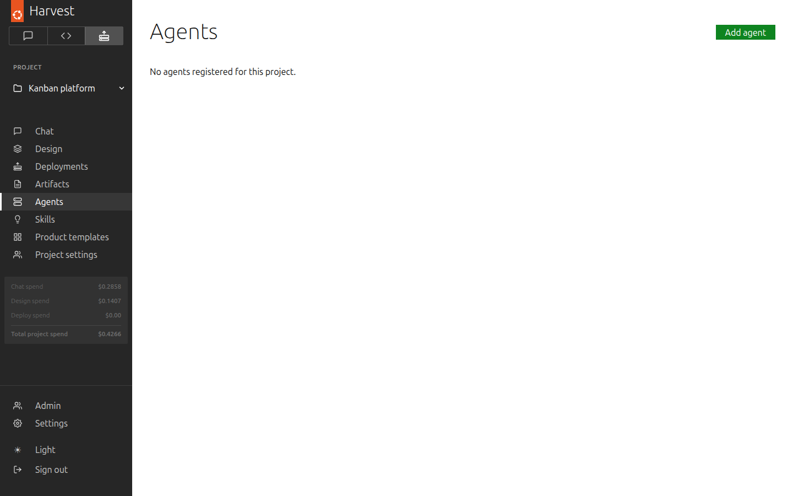

# Connect a machine agent

**Goal:** let a Deploy project run commands on a machine you manage.

1. Set Harvest's public URL so machines can reach it: `sudo harvest agents set-public-url https://harvest.example.com`.
2. In the project, open **Agents** (or **Deployments**) and select **Add agent → Install agent on existing machine**.
3. Run the command shown on the machine, as root:
   ```bash
   curl -fsSL https://harvest.example.com/agents/<project-id>/install.sh | sudo bash
   ```

The installer downloads `harvest-agent`, registers it with a single-use install token and starts it as a service. The agent opens an outbound connection to Harvest: no inbound port is needed on the machine.

The machine appears in **Agents** with its hostname and **Last seen** time.



To remove it, select **Delete** on the agent; then uninstall the service on the machine. Rotate the install token from the project's agents API (`POST /projects/<id>/agents/rotate-install-token`) if a command leaked.
