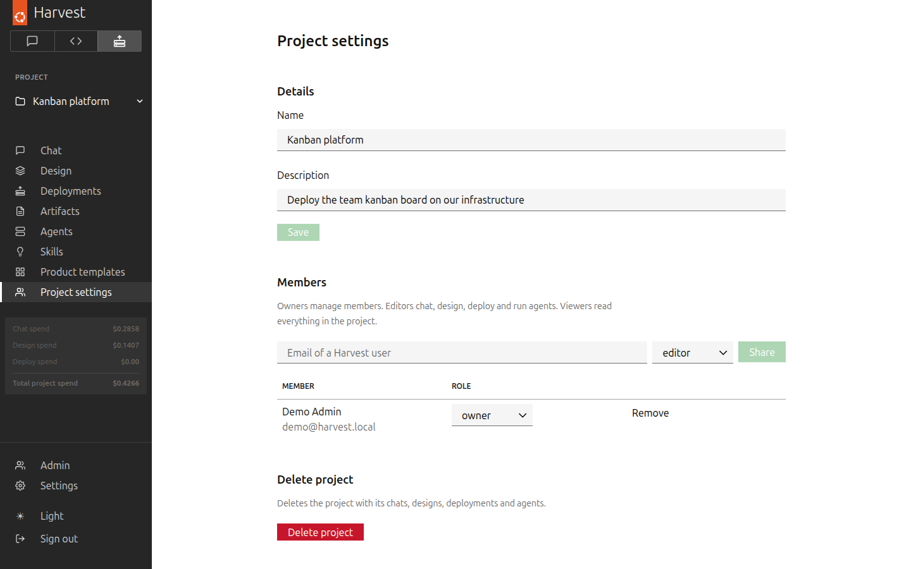

# Create a project and invite members

**Goal:** a shared Deploy workspace for a team.

1. Switch to **Deploy** (server-rack button). Open the **Project** selector and select **New project**.
2. Open **Settings** in the project. Under **Members**, enter a Harvest user's email, choose a role and select **Share**.

| Role | Can |
|---|---|
| Viewer | read chats, artifacts, designs, deployments and agents |
| Editor | everything a viewer can, plus every change: chat, edit artifacts and skills, generate designs, run deployments, manage agents, open consoles, rename the project |
| Owner | everything an editor can, plus manage members and delete the project |

Change a role from the member's row, or **Remove** them. A project always keeps at least one owner. Administrators are owners of every project.

**Delete project** removes its chats, designs, deployments and agents.
