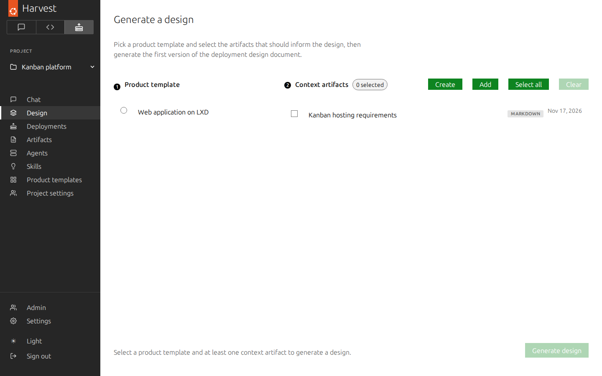
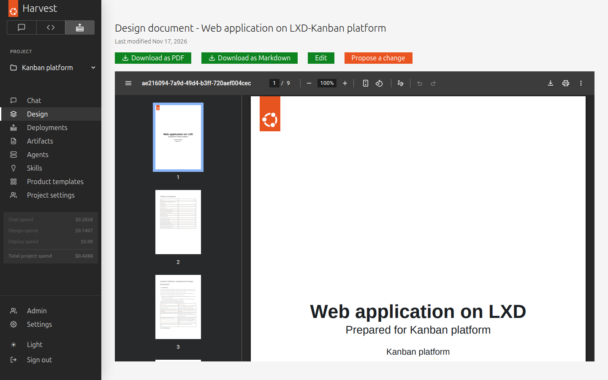

# Generate and revise a design document

**Goal:** a design for a deployment, written from your requirements.

1. In a Deploy project, open **Design** (*Generate a design*).
2. Pick a **Product template**: its `design.md` gives the document's structure.
3. Tick the **Context artifacts** to use, such as requirements or constraints.
4. Select **Generate design**.

The document is written live; leaving the page does not stop it. When it ends it is shown as a PDF.

| To | Do |
|---|---|
| Change wording yourself | **Edit** |
| Have the agent revise it | **Propose a change**, describe the change, then accept or discard the proposed changes |
| Share it | **Download as PDF** or **Download as Markdown** |

The agent may ask questions while it writes when the requirements leave a decision open; answer them in the panel.
