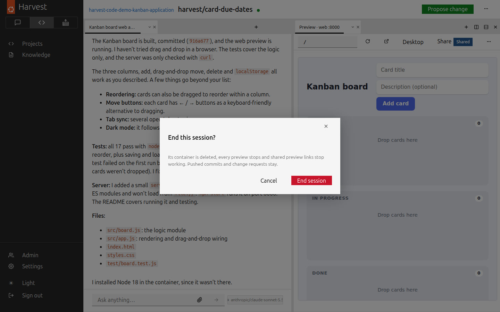

# End a session

Open the session's **⋯** menu (*Session actions*) and select **End session…**, then confirm.

Ending deletes the container, stops every preview and breaks shared preview links. Pushed commits and change requests stay. Unpushed work is lost: push or propose first.

Sessions also end on their own when their change request is merged, or after `idle_hours` without use (default 24).
