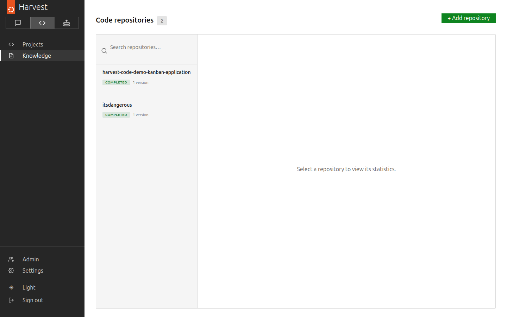

# Index a repository

**Goal:** make a repository's code available to Chat, Code and Deploy.

1. Switch to **Code** and open **Knowledge**. Select **Add repository**.
2. Enter the **Git URL** and select **Next**. Harvest checks that it can read the repository.
3. Adjust the **Name** if you want, pick one or more **Refs** (branches or tags), and confirm.

Each ref becomes a *version*. Progress shows next to the repository; **Completed** means it is ready. Select the repository to see its statistics.

To add more versions later, select the repository, then **+** (*Ingest new versions*).

Opening a repository in Code mode also indexes its default branch.

Big repositories take longer: Harvest parses every source file and records symbols, calls, imports and inheritance. Files it cannot parse are still indexed as text.
