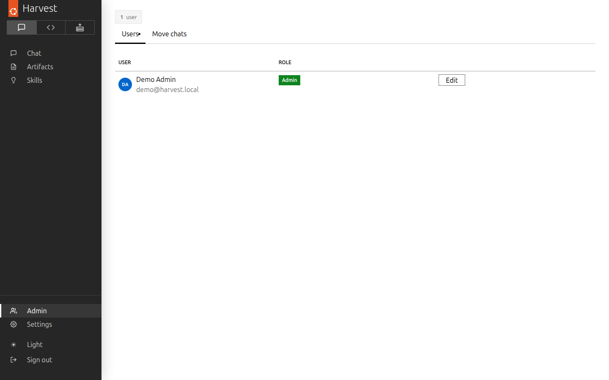

# Manage users and roles

**Goal:** give someone administrator rights, or take them away.

Open **Admin** (administrators only). Select **Edit** on a user, choose **Admin** or **Regular**, and save.

| Role | Can |
|---|---|
| Admin | everything a regular user can, plus: see every repository, manage users, add global skills, delete repositories, open every Deploy project as owner |
| Regular | their own chats, sessions, artifacts and skills; repositories that are public or that their credentials can reach; Deploy projects they are a member of |

Project-level roles (owner, editor, viewer) are set per project: see [Create a project and invite members](create-a-project.md). Full matrix: [Roles and permissions](../reference/permissions.md).
