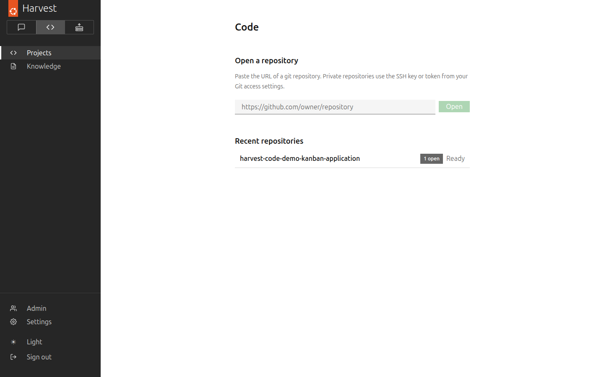
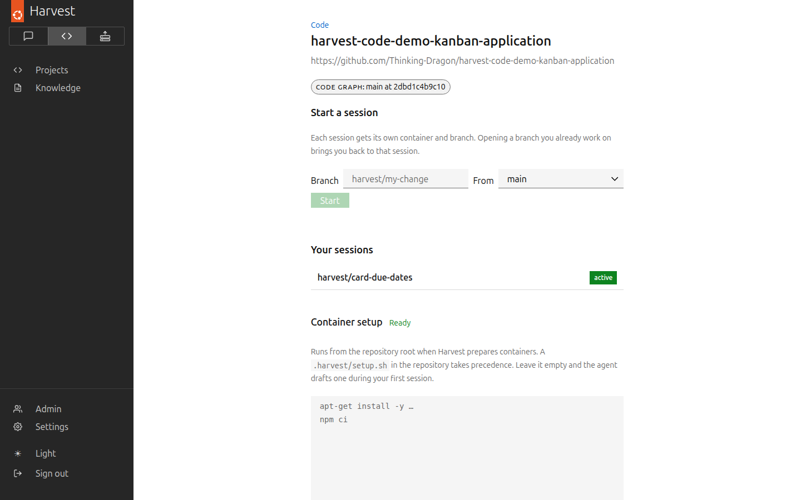

# Open a repository as a code project

**Goal:** a project you can start coding sessions in.

1. Switch to **Code** (the `<>` button).
2. Under **Open a repository**, paste the URL (`https://…` or `git@…`) and select **Open**.

Harvest checks that your credentials can read the repository, indexes its default branch, and builds a container image for it. The project page shows:

- **Code graph**: indexed branch and commit, refreshed when the branch moves.
- **Container setup**: *Being prepared…*, *Ready* or *The last setup failed*.
- **Start a session** and **Your sessions**.

Opening a repository someone else already opened joins the same project: the index and image are shared, sessions are personal. Recently opened projects are listed under **Recent repositories**.
