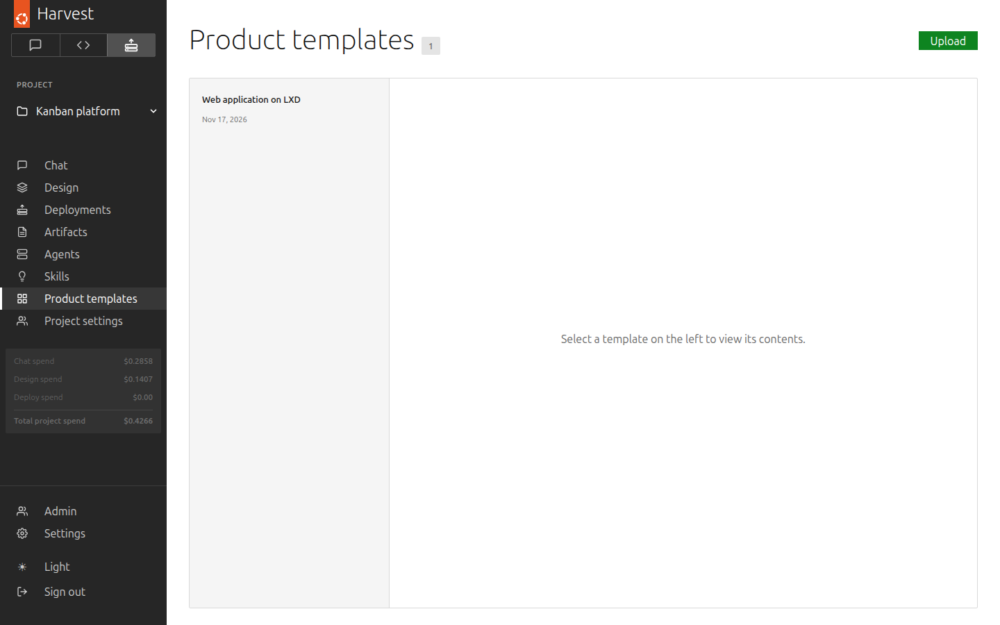

# Create product templates

**Goal:** reuse what you know about a kind of system in every design.

A product template is a `.harvest` file: a zip archive with this layout.

```text
web-app-on-lxd.harvest
├── metadata.yaml        # required: name, description
├── design.md            # required: structure of the design document
├── skills/              # optional: Markdown skills with front matter
│   └── lxd-networking.md
└── artifacts/           # optional: starting artifacts
    ├── main.tf          # .tf, .tf.json → Terraform
    ├── stack.tg.hcl     # .tg, .tg.hcl  → Terragrunt
    ├── install.sh       # .sh, .bash    → Bash
    └── runbook.md       # .md           → Markdown
```

```yaml
# metadata.yaml
name: Web application on LXD
description: nginx, an app server and PostgreSQL in LXD containers, managed by Terraform.
```

```markdown
<!-- design.md -->
# Design
## Requirements
## Architecture
## Containers and sizing
## Networking and TLS
## Backups and recovery
## Risks
```

```markdown
---
name: lxd-networking
description: Use when planning LXD bridges, proxies and port forwards.
---
Prefer one managed bridge per environment...
```

Build and upload it:

```bash
cd web-app-on-lxd && zip -r ../web-app-on-lxd.harvest .
```

Open **Deploy → Product templates**, select **Upload product template** and drop the file. Select a template to see its design template, skills and artifacts; download or delete it from there.


