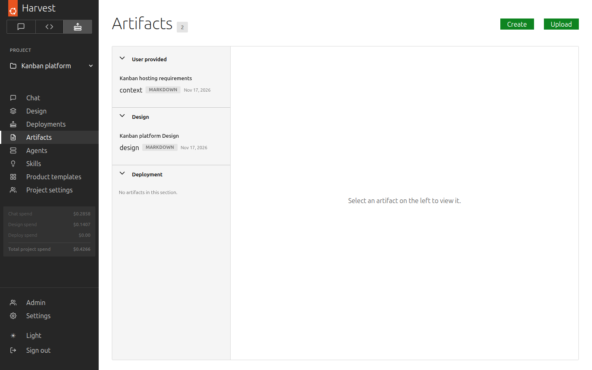

# Generate and run a deployment

**Goal:** turn a design into running infrastructure.

1. Open **Deployments**. **Connect agents**: at least one agent must be connected. Select **Next**.
2. Harvest generates the deployment artifacts from the design: Terraform, Terragrunt and Bash, and an execution plan that orders them across agents.
3. Review the **Deployment artifacts**. Select one to read or edit it.
   - **Propose a change**: describe a change; review the **Proposed changes** and approve or discard.
   - **Add artifact**: add your own step to the plan.
4. Select **Deploy**. Steps run on their agents in dependency order; output streams live. **Run this step** runs a single step.
5. Each run is kept in **Run history** with its output.

**Destroy** runs the teardown in reverse order. Selecting **Deploy** again after changes redeploys.

Terraform and Terragrunt steps run on the agent; the agent installs Terraform when it is missing.
