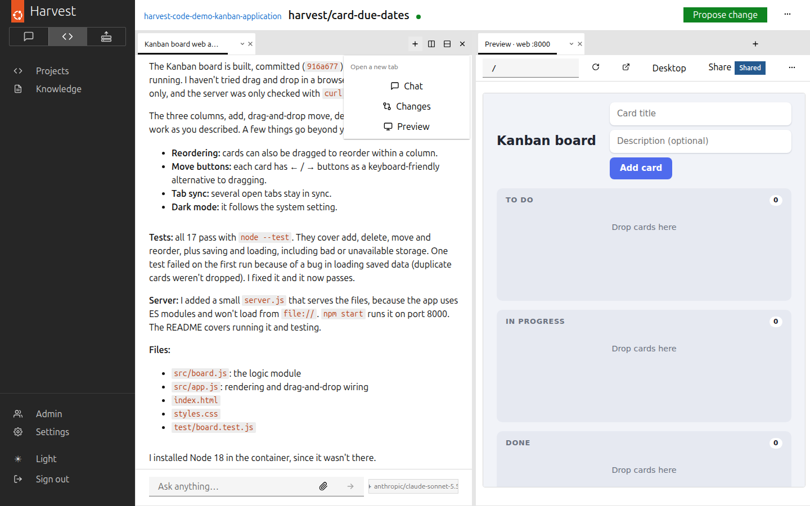
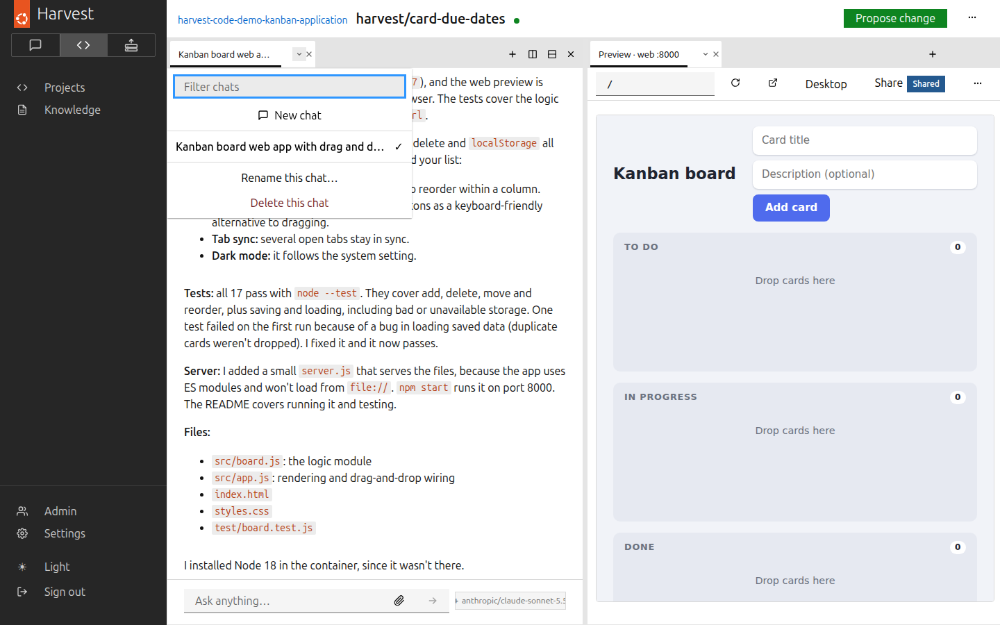
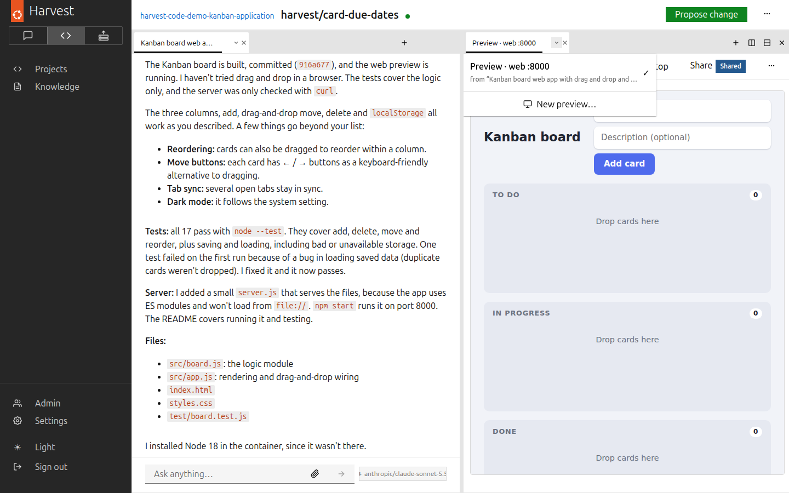
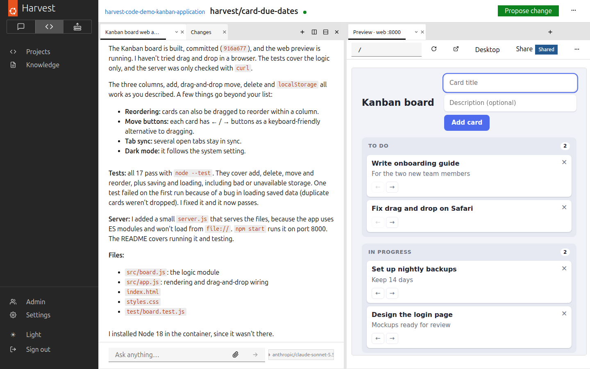

# Work with several chats and tabs in a session

**Goal:** chat with the agent, review changes and try the app side by side.

A session opens on one chat tab. Every new tab asks what to show:

| Tab | Shows |
|---|---|
| **Chat** | a conversation with the coding agent |
| **Changes** | the session's commits and diff against the base branch |
| **Preview** | a running copy of the app |

- **+** or `Ctrl+Alt+T` opens a tab; the split buttons, `Ctrl+Alt+\` and `Ctrl+Alt+-` split the pane.
- A chat or preview tab's title opens a list of the session's chats or previews: switch to an older one, start a new one, rename or delete it.

Chats share the session's container and branch: changes made in one are visible in all. Use separate chats to keep unrelated tasks' conversations apart.

The layout is saved per session and comes back when you reopen it.

