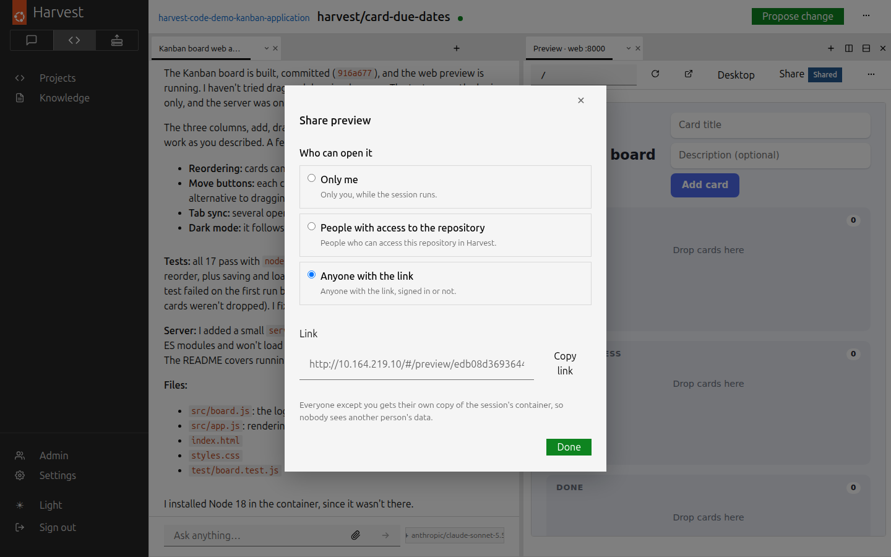
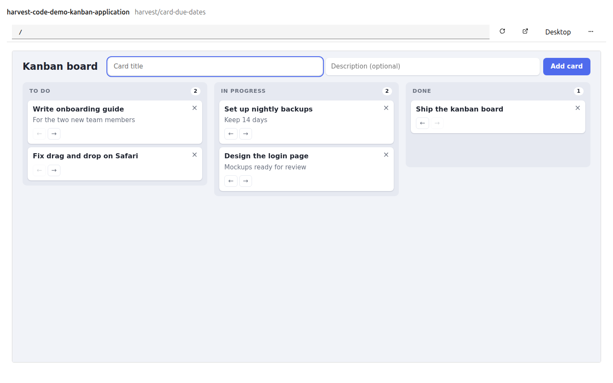

# Share a preview

**Goal:** let others try the work without installing anything.

Select **Share** on the preview and choose who can open it:

| Option | Who |
|---|---|
| **Only me** | you, while the session runs |
| **People with access to the repository** | Harvest users who can see the repository; they sign in |
| **Anyone with the link** | anyone, signed in or not |

Then **Copy link**.

Each viewer gets their own copy of the app, started from your workspace at that moment, so they cannot disturb your session or each other. A viewer can start over with **Fresh copy of the app**.

At most `max_preview_copies` copies (default 5) run at once per preview; the least recently used is stopped first. The link stops working when the preview is deleted, expires, or its session ends.
