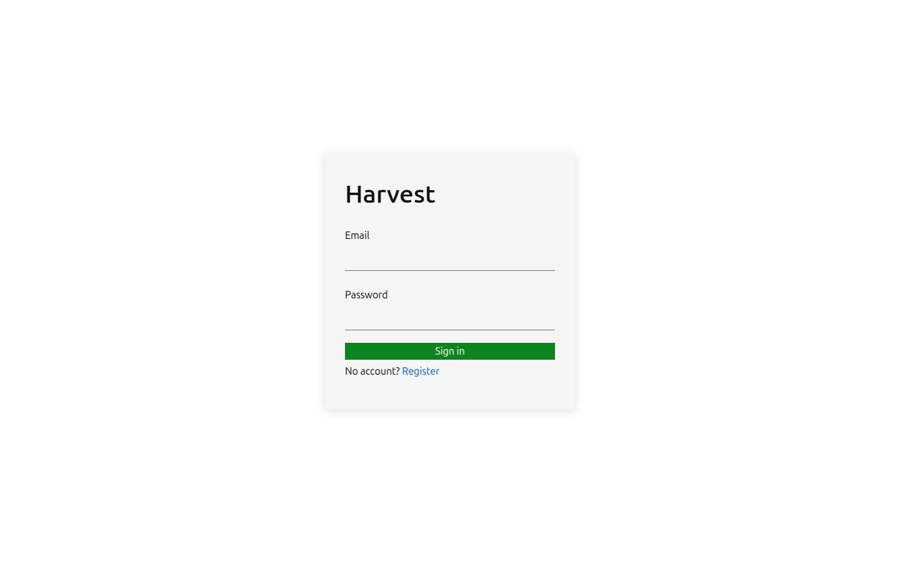

# Sign users in with Google or OIDC

**Goal:** users sign in with your identity provider instead of a Harvest password.

1. Register Harvest as an application with the provider. Use these redirect URIs:
   - Google: `https://harvest.example.com/auth/google/callback`
   - OIDC (Keycloak, Okta, Entra ID, Authentik…): `https://harvest.example.com/auth/oidc/callback`
2. Give Harvest the client details:
   ```bash
   sudo harvest identity provider enable google \
     --client-id <id> --client-secret <secret> \
     --redirect-uri https://harvest.example.com/auth/google/callback

   sudo harvest identity provider enable oidc \
     --issuer-url https://sso.example.com/realms/main \
     --client-id <id> --client-secret <secret> \
     --redirect-uri https://harvest.example.com/auth/oidc/callback \
     --display-name "Company SSO"
   ```
   In `server.toml`: `[auth.google]` or `[auth.oidc]` with the same fields.
3. The sign-in page shows a button for each provider.

   

   To allow only single sign-on: `sudo harvest auth local-login set false`.

The first account to sign in on a new server becomes the administrator, whichever method it uses.
