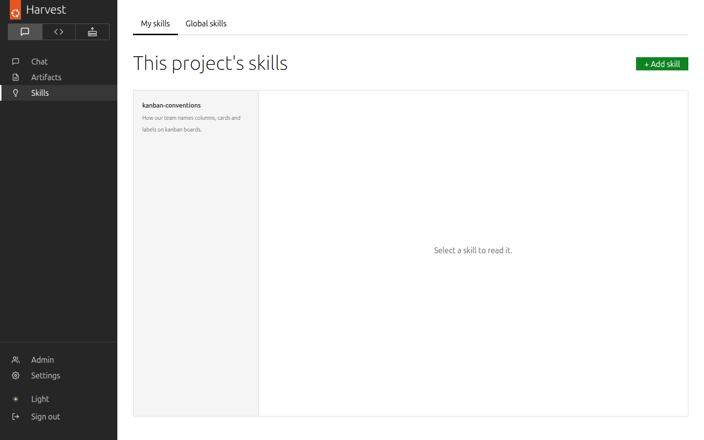

# Write a skill

**Goal:** teach the agent how your team does something, once.

A skill is a named Markdown document the agent loads when a task needs it, for example your naming conventions or how to operate a product.

1. Open **Skills** (in Chat for a personal skill, in Deploy for a project skill) and select **New skill**.
2. Fill in **Name** (short, lowercase, e.g. `kanban-conventions`), **Description** (one line: when to use it) and **Content**.

```markdown
# Kanban conventions

Use the columns To do, In progress and Done. Card titles start with a verb.
Keep descriptions under three sentences.
```

The agent sees every skill's name and description, and reads the content with its `load_skill` tool when the description matches the task. Write the description for that decision.



Administrators can add global skills, available to everyone. Harvest ships global skills for Canonical products such as LXD, Juju, Ceph and OpenStack.
