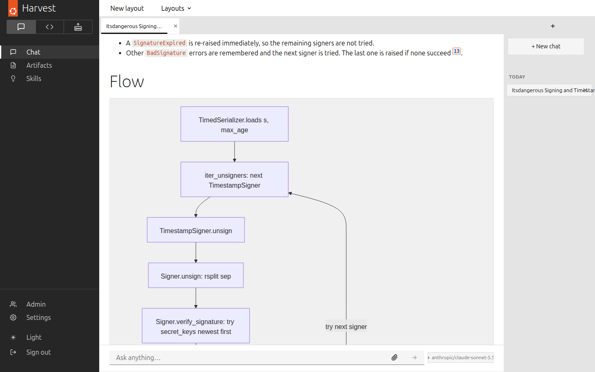
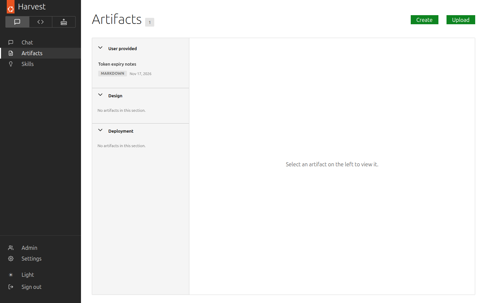
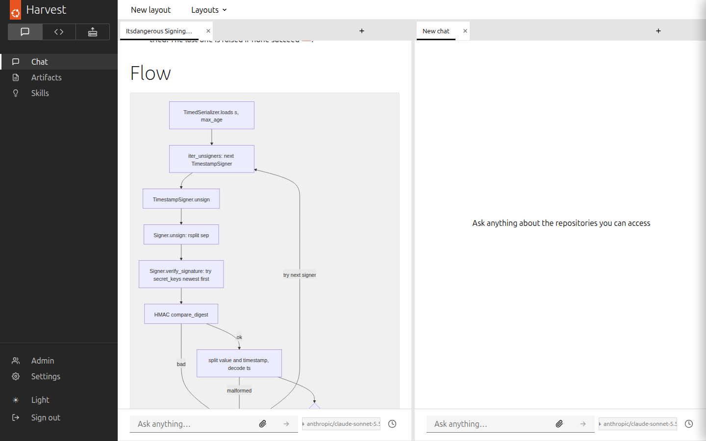
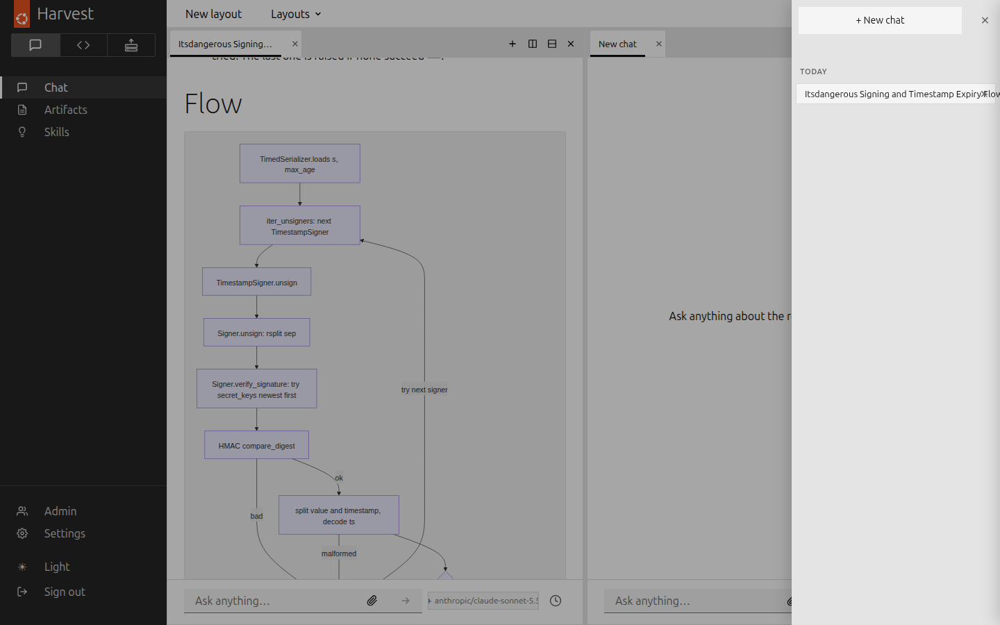

# Ask questions about a codebase

In this tutorial you investigate a library with Chat: follow an answer to its sources, ask for a diagram, keep the result, and compare two lines of enquiry side by side. It uses the `itsdangerous` repository indexed in [Get started](get-started.md).

## 1. Ask a precise question

In **Chat**, ask:

> How does itsdangerous sign data and verify that a timestamped token has not expired? Walk me through the main classes and draw a small diagram of the flow.

While it works, the status line shows each step, for example *Searching code* and *Reading sources*. Expand it with **Show steps** to see every tool call and its result.

## 2. Check the sources

Each claim ends with a citation number. **Sources** under the answer lists every file and line range used. Select one to open the exact code in a side panel. Answers that rely on documentation instead of code say so.

## 3. Read the diagram

Answers can include diagrams. They are drawn from the code the agent read and follow the light or dark theme.

## 4. Follow up

Ask a follow-up in the same tab:

> What happens when the secret key is rotated?

The agent keeps the conversation's context and reads more code only where needed.

## 5. Keep the answer

Ask the agent to keep a summary, for example:

> Save a short note on token expiry as an artifact.

It appears under **Artifacts** in the navigation, where you can edit or download it.

## 6. Compare two conversations

Select the split button (two panes) at the top right of the chat. A new tab opens beside the first. Ask an unrelated question there; both panes keep their own conversation.

Open the history with the clock button next to the model picker to return to earlier conversations.

## What you learned

- Answers are grounded in indexed code and cite it.
- Steps, sources and diagrams let you check an answer instead of trusting it.
- Artifacts keep what is worth keeping; panes keep parallel lines of work apart.

Next: [Build a feature with a coding session](build-a-feature-with-a-coding-session.md).
