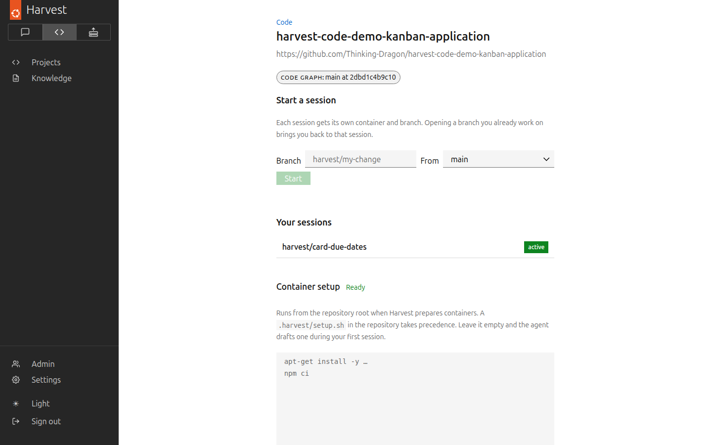
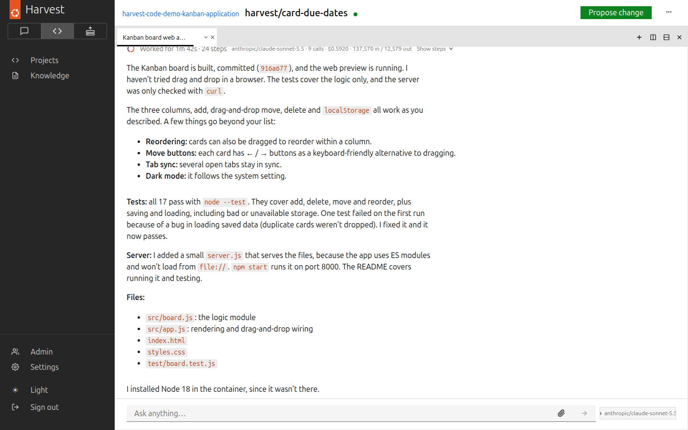
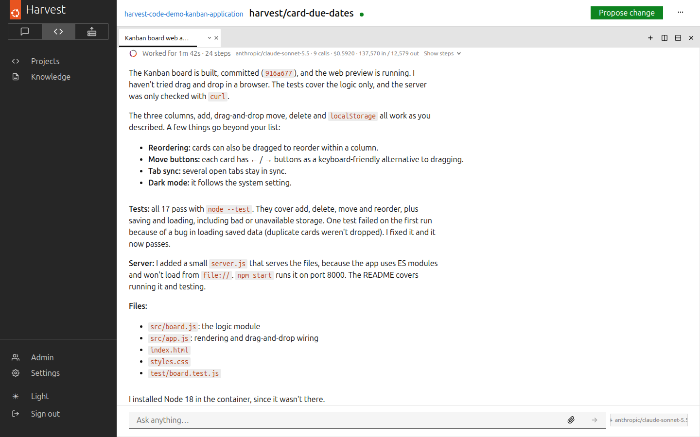
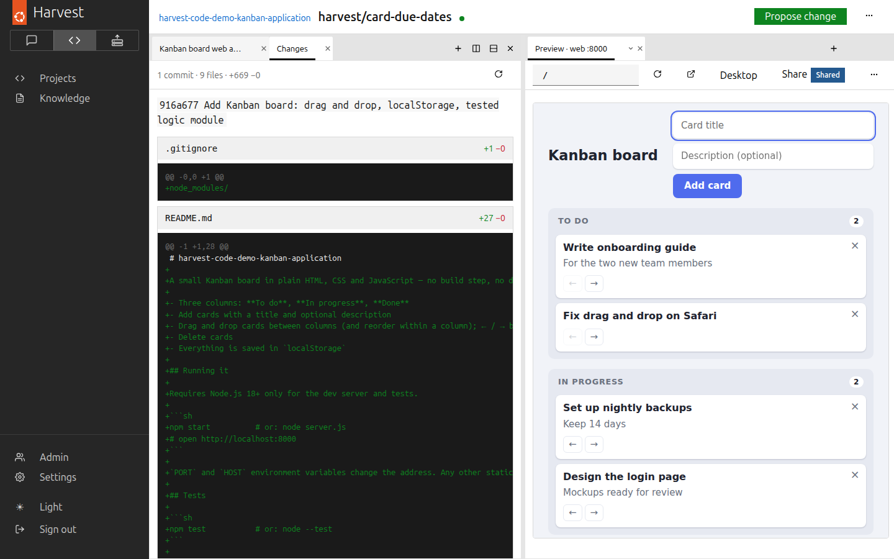
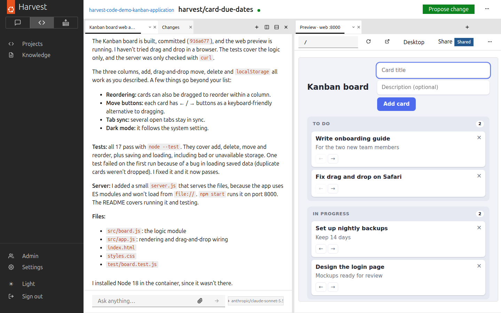
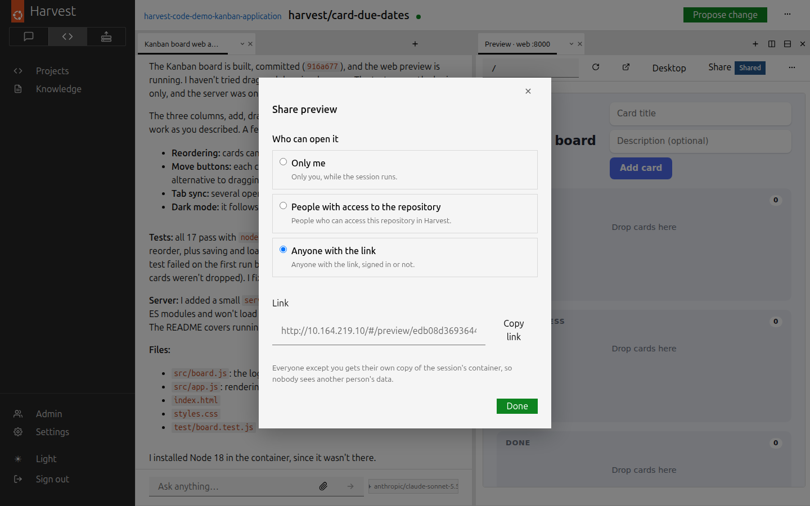
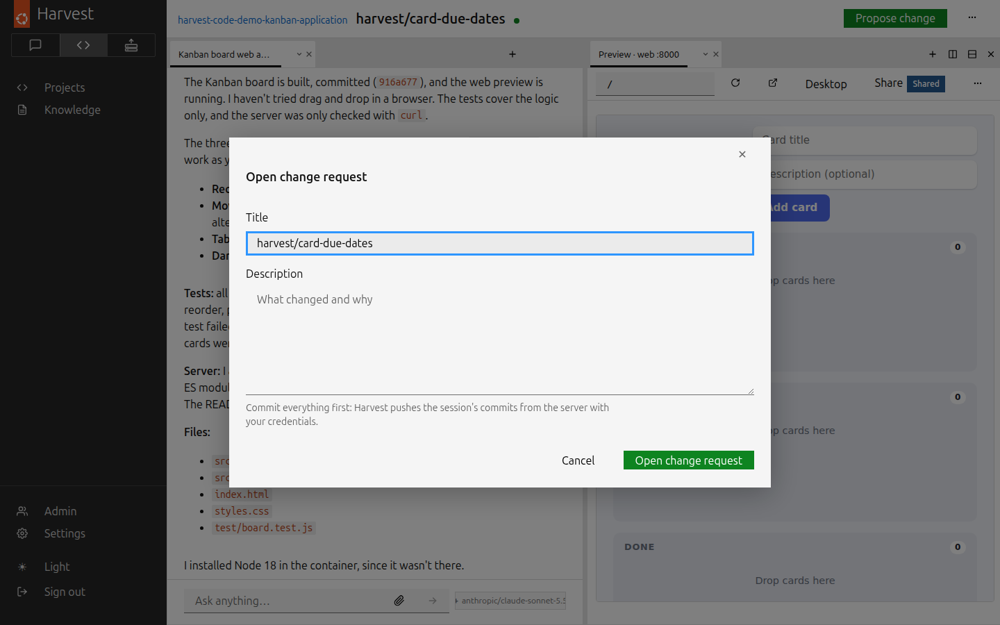

# Build a feature with a coding session

In this tutorial you give Harvest's coding agent a task on a real repository, review what it wrote, try the result in a live preview, share it, and turn it into a pull request. Harvest must have [Code mode enabled](../how-to/enable-code-mode.md).

## 1. Open the repository

Switch to **Code** (the `<>` button). Under **Open a repository**, paste a repository URL and select **Open**. For a private repository, add an SSH key or a platform token first: see [Index private repositories](../how-to/index-private-repositories.md).

Harvest indexes the repository and prepares a container image for it. The project page shows both:

- **Code graph**: the indexed branch and commit.
- **Container setup**: *Being prepared…*, then *Ready*, usually within a few minutes.

## 2. Start a session

Under **Start a session**, enter a branch name such as `harvest/kanban-board`, keep **From** on the default branch, and select **Start**. A session is your own container with the repository checked out on that branch. It starts in seconds when a warm container is ready.

## 3. Give the agent a task

The session opens on a chat. Describe the result you want, including how to check it:

> Build a small Kanban board in plain HTML, CSS and JavaScript: three columns, add, move and delete cards, saved in localStorage. Keep the logic in a module with unit tests that run with `node --test`. Run the tests, commit, and set up a web preview.

The agent reads the code, installs what it needs, writes files, runs the tests, fixes failures and commits. Each tool it uses appears in the chat.

It ends with a summary that says what it built, what it tested and what it did not check.

## 4. Review the changes

Select **+** at the top of the pane and choose **Changes**. You see the commits and one section per changed file, with lines added and removed.

## 5. Try it

Select the split button and choose **Preview**. The app runs at its own address and shows inside Harvest. Use it as you would locally: here, cards were added and moved between columns.

Use the path field to open another page of the app, **Open in new tab** to leave Harvest, and **Desktop** to switch to tablet or phone width.

## 6. Share it

Select **Share** and choose **Anyone with the link**, then **Copy link**. Whoever opens the link gets their own copy of the app, without an account.

## 7. Propose the change

Add your GitHub account under **Settings → Git access** if you have not. Then select **Propose change**, give it a title and description, and select **Open change request**. Harvest pushes the branch from the server with your credentials and opens the pull request. A chip in the header links to it and shows its state.

When the pull request is merged, the session ends by itself.

## What you learned

- A session is a container, a branch and any number of chats, previews and change views.
- The agent works like a developer: it reads, edits, tests and commits, and reports what it checked.
- Previews and change requests turn the work into something others can try and review.

Next: [Plan a deployment from requirements to design](plan-a-deployment.md).
