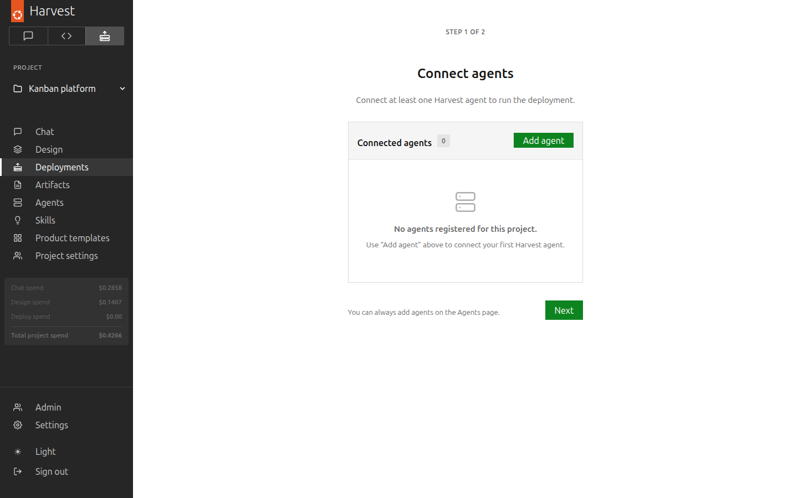

# Deploy to your own machines

In this tutorial you connect a machine to the project from [Plan a deployment](plan-a-deployment.md), generate the deployment artifacts from the design, and run them.

You need a design document and one Linux machine that can reach Harvest over HTTPS, or an LXD server configured in Harvest.

## 1. Connect an agent

Open **Deployments**. Step 1 asks for at least one connected agent.



Select **Add agent**, then either:

- **Install agent on existing machine**: copy the command shown and run it on the machine:
  ```bash
  curl -fsSL https://harvest.example.com/agents/<project-id>/install.sh | sudo bash
  ```
- **Let Harvest create and manage agent**: pick a size. Harvest creates an LXD container and installs the agent in it (requires [LXD in Harvest](../how-to/lxd-agents.md)).

The agent appears under **Connected agents** within a few seconds. Select **Next**.

## 2. Generate the deployment artifacts

Step 2 turns the design into deployment artifacts: Terraform and the scripts that configure the machines. Generation streams live and takes a few minutes.

## 3. Review the artifacts

When generation ends you see the **Deployment artifacts**. Read them before running anything. To change them, select **Propose a change** and describe the change; approve or discard the proposal.

## 4. Deploy

Select **Deploy**. Harvest runs the artifacts on your agents in dependency order and streams their output. Each run is recorded with its status.

## 5. Tear down

**Destroy** removes what the deployment created, running the same artifacts in reverse order.

## What you learned

- Agents execute deployments on machines you control; Harvest never connects to them, they connect to Harvest.
- Deployment artifacts are generated from the design and reviewed before they run.
- Deploy and Destroy run the same artifacts forwards and backwards.

Continue with the [how-to guides](../README.md#how-to-guides) for day-to-day tasks.
