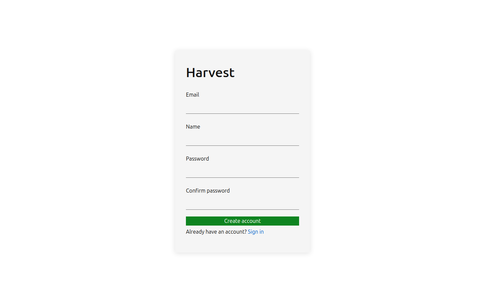
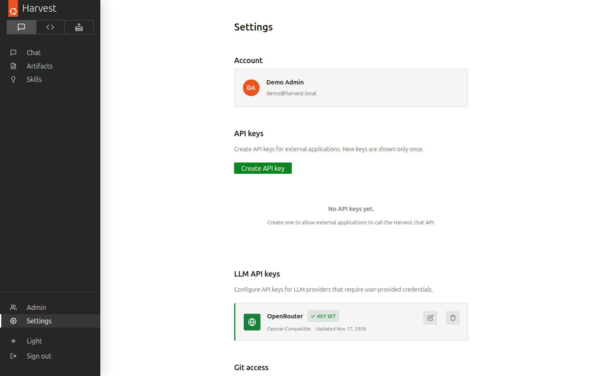
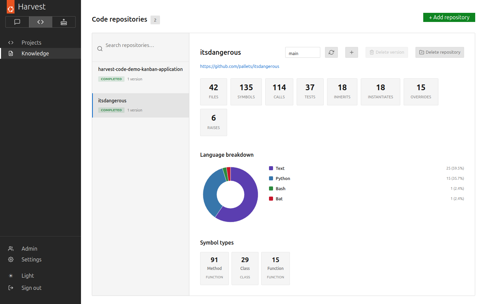
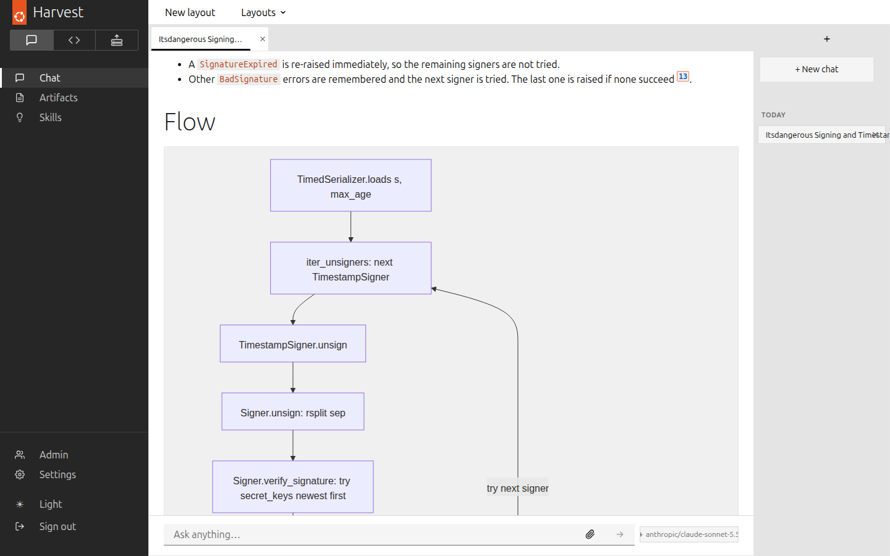

# Get started with Harvest

In this tutorial you install Harvest, create the first account, connect a language model, index a repository and ask your first question. It takes about 20 minutes.

You need an Ubuntu machine with `snapd`, a PostgreSQL 14+ server with the `vector` and `pg_trgm` extensions available, and an API key for Anthropic, Google Gemini, or an OpenAI-compatible service such as OpenRouter.

## 1. Install and initialise

```bash
sudo snap install harvest --edge
harvest prepare-db-script | sudo bash -x
```

The script creates the database and prints a `database.url`. Run the guided setup with it:

```bash
sudo harvest init
harvest status
```

`harvest status` reports both services (`harvest.server` and `harvest.ui`) as healthy. Open the web UI at `http://<host>:3000`.

## 2. Create the first account

Open **Register**, enter your name, email and a password. The first account on a server becomes its administrator.



## 3. Add your model key

Open **Settings** at the bottom of the navigation. Under **LLM API keys**, select **Edit** on your provider, paste the key and save. The provider shows **Key set**.



If `harvest init` already stored a server-wide key, the provider shows as ready and you can skip this step.

## 4. Index a repository

Switch to **Code** with the `<>` button at the top of the navigation, open **Knowledge**, and select **Add repository**.

1. Enter a Git URL, for example `https://github.com/pallets/itsdangerous`, and select **Next**.
2. Keep the suggested name, pick the `main` ref, and confirm.

The repository shows **Completed** when indexing ends. Select it to see what Harvest found: files, symbols, calls and tests.



## 5. Ask a question

Switch to **Chat** and ask:

> How does itsdangerous sign data and check that a token has expired?

Harvest searches the indexed code, reads the relevant functions and answers with numbered citations. Select a citation to open the source.



## What you learned

- Harvest stores everything in PostgreSQL and is configured with the `harvest` CLI.
- Models are reached with a server key or with each user's own key.
- Repositories are indexed once per version, then every chat can use them.

Next: [Ask questions about a codebase](ask-questions-about-a-codebase.md).
