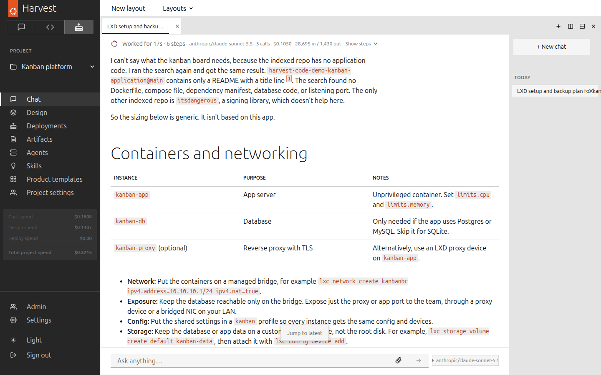
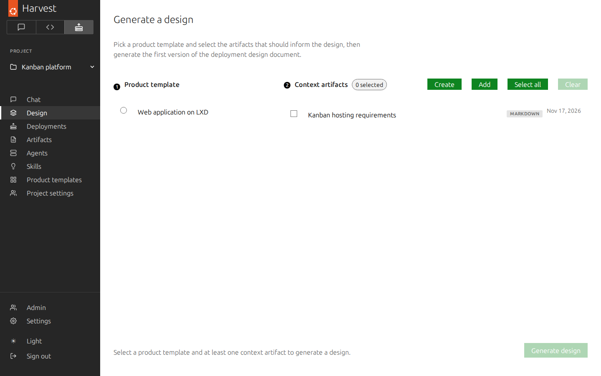
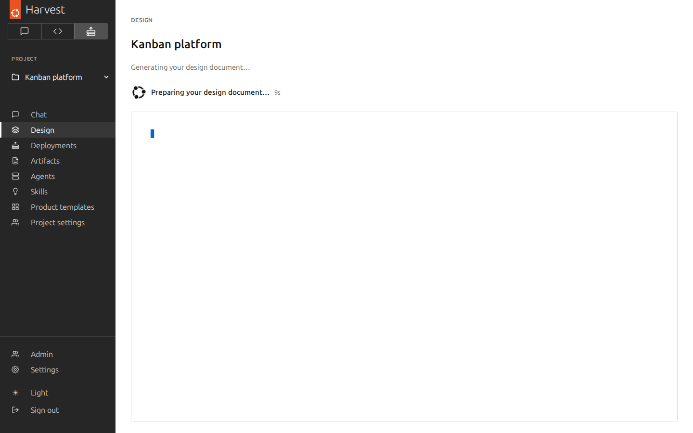
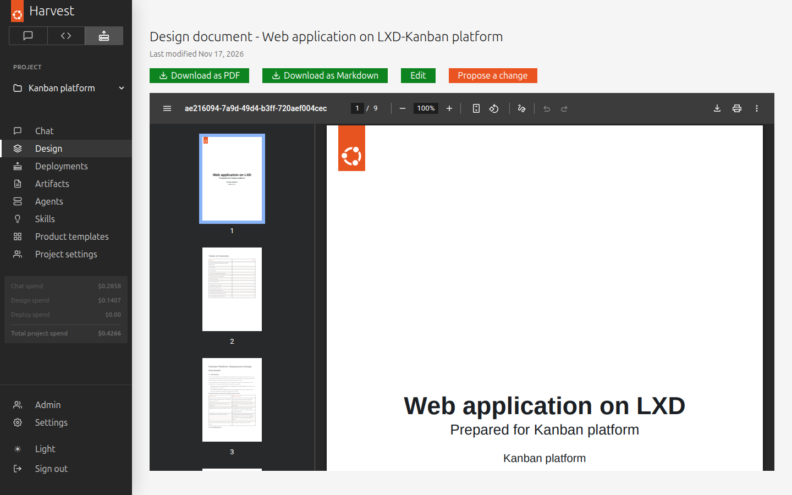

# Plan a deployment from requirements to design

In this tutorial you create a Deploy project, describe what you need, and have Harvest generate a design document you can download and revise.

## 1. Create a project

Switch to **Deploy** (the server-rack button). Open the **Project** selector and select **New project**. Name it, for example *Kanban platform*.

## 2. Add a product template

A product template describes a kind of system you deploy: the structure of its design document, the skills the agent should use, and starting artifacts. Open **Product templates** and upload a `.harvest` file, for example one for *a web application on LXD: nginx, an app server and PostgreSQL, managed by Terraform*. See [Create product templates](../how-to/product-templates.md) for the format.

## 3. Add your requirements

Open **Artifacts** and add a Markdown artifact with your requirements, for example *Serve the board to 50 internal users over HTTPS. One Ubuntu 24.04 host with LXD. Nightly backups kept 14 days.*

## 4. Talk it through

Open **Chat** in the project and ask about the infrastructure:

> Which LXD containers and networking do we need to run the team kanban board, and how should we back it up?

Project conversations are shared with the project's members.

## 5. Generate the design

Open **Design**. Pick your product template, tick your requirements artifact, and select **Generate design**.

The agent writes the design live. It takes a few minutes.

## 6. Read and revise it

The finished design is shown as a PDF. Use **Download as PDF** or **Download as Markdown** to share it, **Edit** to change the text yourself, or **Propose a change** to ask the agent to revise it.

## What you learned

- A Deploy project groups chat, artifacts, skills, templates and members.
- Templates and artifacts are the inputs; the design document is the output.
- You can revise the design by hand or by proposal.

Next: [Deploy to your own machines](deploy-to-your-machines.md).
